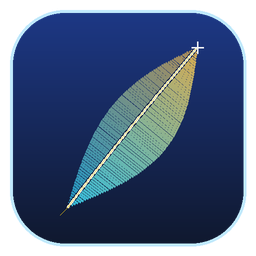

# 🪶 فَصِيح (Faseeh) - مصحح الكيبورد الذكي لنظام ويندوز

<p align="center">
  <b>أداة ذكية وخفيفة تعمل في الخلفية لتصحيح النصوص المكتوبة بلغة خاطئة فوراً بضغطة زر.</b><br>
  حل جذري لمشكلة نسيان لغة الكيبورد بين العربية والإنجليزية.
</p>

<p align="center">
  
</p>

---

## ⚡ المشكلة والحل:
- **المشكلة:** تكتب نصاً طويلاً وأنت تظن أنك تكتب بالعربية، فتفاجأ بنص غير مفهوم مثل:  
  `;dt phg;` (والمقصود: `كيف حالك`).
- **الحل مع فَصِيح:** ظلل النص واضغط أحد الاختصارات السريعة، وسيتحول النص فوراً في مكانه دون مسح أو إعادة كتابة!

---

## ✨ المميزات الرئيسية:
- 🚀 **تصحيح فوري وآمن:** يستبدل النص في جزء من الثانية في أي برنامج (Word, Telegram, WhatsApp, المتصفحات، المفكرة، إلخ).
- 🔄 **تحويل ثنائي الاتجاه:** من الإنجليزية إلى العربية، ومن العربية إلى الإنجليزية.
- 🛡️ **إحصائيات الإنقاذ والوقت الموفّر:** يحسب لك التطبيق بدقة كم مرة تم إنقاذك من إعادة الكتابة، وكم وفرت من وقت (ساعات، دقائق، ثواني).
- ⌨️ **اختصارات مدروسة وآمنة:**
  - `Ctrl + Shift + A` (مريح وسهل التذكر: حرف A يعني عربي / Auto-Fix).
  - `Alt + Q` (مفتاحان فقط، آمن ولا يغلق النوافذ).
  - `F9` أو `Fn + F9` (زر واحد مباشر).
- ⚡ **تشغيل تلقائي مع إقلاع الويندوز:** يعمل في الخلفية بهدوء مع خيار تفعيل أو إلغاء بنقرة زر.
- 🔄 **نظام تحديثات مدمج (Auto-Updater):** يفحص التحديثات الجديدة ويحدث نفسه بضغطة زر واحدة.
- 🔒 **خصوصية تامة 100%:** التطبيق يعمل محلياً بالكامل على جهازك ولا يرسل أي نصوص أو بيانات عبر الإنترنت.

---

## 📥 التحميل والاستخدام المباشر:
1. حمّل ملف البرنامج الجاهز: **[Faseeh-ArabicKeyFix.exe](dist/Faseeh-ArabicKeyFix.exe)**
2. اضغط على الملف مرتين وسيعمل معك فوراً دون الحاجة لتثبيت بايثون أو أي برامج أخرى!

---

## 👨‍💻 التطوير والتشغيل من المصدر:
إذا كنت مطوراً وتريد تشغيل أو تعديل الكود بنفسك:
```bash
# 1. تثبيت المتطلبات
pip install keyboard pyperclip pillow pyinstaller

# 2. تشغيل التطبيق
python app.py

# 3. بناء ملف تنفيذي مستقل
pyinstaller --noconfirm --onefile --windowed --icon="app_icon.ico" --add-data "app_icon.png;." --add-data "app_icon.ico;." --name "Faseeh-ArabicKeyFix" app.py
```

---

<p align="center">
  صنع بكل فخر لدعم اللغة العربية وتسهيل تجربة الكتابة على الكمبيوتر 🪶✨
</p>
